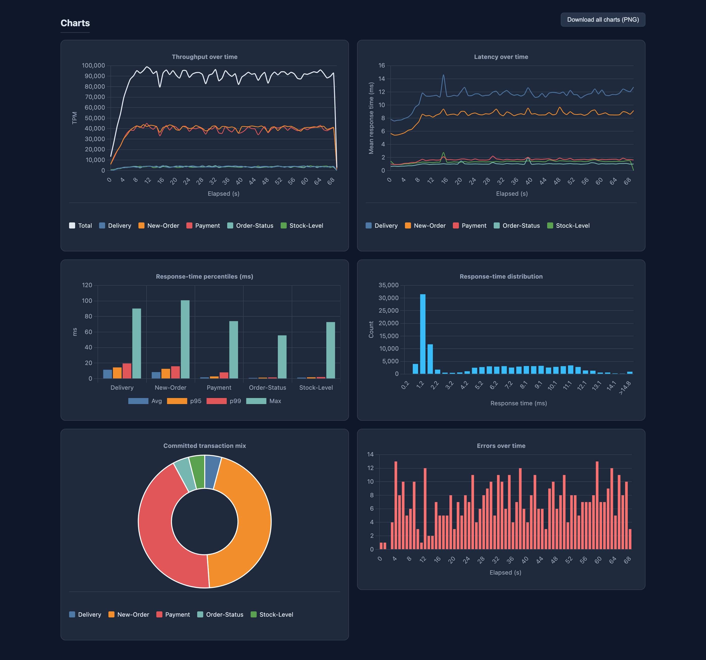
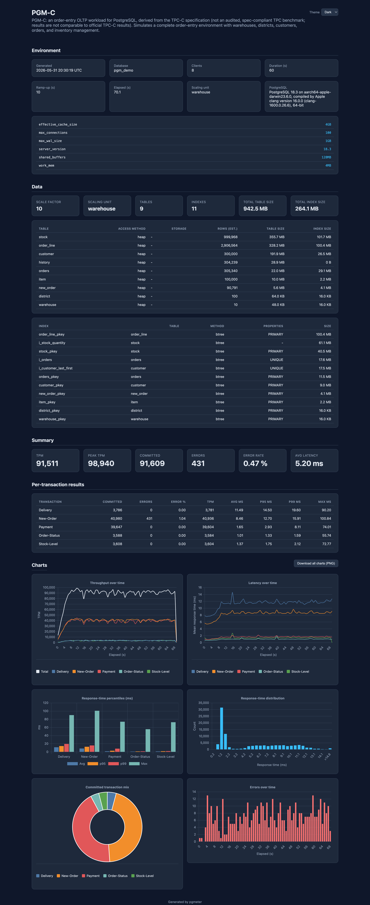

# pgmeter

[](https://github.com/julmon/pgmeter/actions/workflows/ci.yml)

A next-generation PostgreSQL benchmarking tool written in Rust. pgmeter runs
**user-defined benchmarks described in YAML + Lua**: you declare your schema,
data loading, and transaction mix in a spec file, and pgmeter initializes the
database and drives the workload — no Rust code or recompilation required.

Reference workloads (PGM-B, PGM-C, PGM-H, PGM-DS, PGM-IoT) ship as ready-to-run
specs under [`samples/`](samples/). These are **derived from** the corresponding
TPC and TPCx benchmark specifications; see the [trademark notice](#trademark-notice)
below — they are not audited, full-specification TPC benchmarks.

## Features

- **YAML-defined benchmarks**: Describe schema, indexes, data loading, and the
  transaction mix declaratively in a single spec file.
- **Lua scripting**: Implement transaction logic and data generation in Lua
  (Luau), with a built-in PostgreSQL bridge (`exec`, `query`, `copy_*`,
  transaction control) and fast random-data helpers.
- **Bundled reference specs**: PGM-B, PGM-C, PGM-H, PGM-DS, and PGM-IoT (derived
  from TPC-B/C/H/DS and TPCx-IoT), validated to match hand-written native
  implementations.
- **Concurrent clients** with a configurable **ramp-up period**.
- **Data aggregation & statistics**: Response-time percentiles (95th, 99th),
  throughput (TPM/TPS), and error rates.
- **Parallel data loading** for faster initialization.

## Requirements

- Rust 1.87 or later (declared as `rust-version` in `Cargo.toml`)
- PostgreSQL 12 or later
- Linux or macOS (developed and tested on Linux; Windows is not supported)

## Installation

### From Source

```bash
git clone https://github.com/julmon/pgmeter.git
cd pgmeter
cargo build --release
```

The binary will be available at `target/release/pgmeter`.

## Usage

pgmeter uses PostgreSQL connection parameters similar to standard PostgreSQL tools
(psql, pgbench). Every workload is driven by a YAML spec passed with `--spec`.

### Connection Options

| Option | Environment Variable | Default | Description |
|--------|---------------------|---------|-------------|
| `-H, --host` | `PGHOST` | localhost | Database server host or socket directory |
| `-p, --port` | `PGPORT` | 5432 | Database server port |
| `-U, --username` | `PGUSER` | (current user) | Database user name |
| `-d, --dbname` | `PGDATABASE` | (current user) | Database name to connect to |
| `--sslmode` | `PGSSLMODE` | prefer | TLS: `disable`, `prefer`, `require` (encrypt, no certificate check), `verify-ca` or `verify-full` (encrypt and check the server certificate against the system CA store) |

The password can be provided via the `PGPASSWORD` environment variable.
TLS uses rustls, so nothing has to be installed; `sslmode=require` matches
libpq in encrypting without authenticating the server, and the `verify-*`
modes need the server's CA in the system store (a custom CA file is not
supported yet).

### Workflow

A benchmark is run in two phases — initialize the database, then run the
workload:

```bash
# 1. Initialize: create schema and load data (scale factor 10, 4 loader threads)
pgmeter -H localhost -d benchmark init --spec samples/pgm-b -s 10 -j 4

# 2. Run: 8 clients for 60 seconds with a 10 second ramp-up
pgmeter -H localhost -d benchmark run --spec samples/pgm-b -c 8 -T 60 -r 10
```

Swap the `--spec` file to run a different workload — the same `init`/`run` flow
applies to every spec, including your own.

The bundled workloads are embedded in the binary, so you do not need a source
checkout to use them. `spec list` shows them and `spec new` writes an editable
copy (the `spec.yaml` plus its Lua scripts) that you can then tune and run:

```bash
pgmeter spec list                  # bundled benchmarks and what they model
pgmeter spec new pgm-c -o .        # writes ./pgm-c/spec.yaml and ./pgm-c/scripts/
#   ... edit pgm-c/spec.yaml (schema, constants, weights, SQL) ...
pgmeter -d benchmark init --spec pgm-c -s 10 -j 4
pgmeter -d benchmark run  --spec pgm-c -c 8 -T 60
```

`spec new` refuses to overwrite an existing directory unless `--force` is given.

### Bundled Reference Specs

| Spec | Workload | Type | Derived from | Scale unit |
|------|----------|------|--------------|------------|
| `samples/pgm-b` | Banking debit/credit (single transaction) | OLTP | TPC-B | branch |
| `samples/pgm-c` | Order-entry (New-Order, Payment, Order-Status, Delivery, Stock-Level); ~1% of New-Orders roll back by design and show up as errors | OLTP | TPC-C | warehouse |
| `samples/pgm-iot` | IoT gateway (Data-Ingestion, Scan/Device/Alert queries, Threshold-Update) | TIMESERIES | TPCx-IoT | substation |
| `samples/pgm-h` | Decision-support (22 analytical queries) | OLAP | TPC-H | scale factor |
| `samples/pgm-ds` | Decision-support, snowflake schema (24 tables) | OLAP | TPC-DS | scale factor |
| `samples/custom-simple` | Minimal example of a user-defined workload | OLTP | — | tenant |

### Writing Your Own Benchmark

Start from the smallest template, `pgmeter spec new custom-simple -o .`, which
scaffolds a single-table, single-transaction spec, or from the bundled workload
closest to yours. The full authoring guide — every spec field, the row-template
language, both data-loading styles, the simple/script transaction modes, and
the complete Lua API reference — lives in
[`docs/yaml-benchmarks.md`](docs/yaml-benchmarks.md). It includes a worked
from-scratch example.

## Command Options

### Init Options (`init`)

> **`init` is destructive.** It issues `DROP TABLE IF EXISTS ... CASCADE` for
> every table declared in the spec before recreating and loading it, so point it
> at a database (or schema) you can afford to wipe.

| Option | Default | Description |
|--------|---------|-------------|
| `--spec` | (required) | Benchmark directory (containing `spec.yaml`) or a single spec file |
| `-s, --scalefactor` | 1 | Scale factor (meaning is defined by the spec's `scaling.unit`) |
| `-j, --jobs` | 1 | Number of parallel threads for data loading |
| `--no-fkey` | false | Skip foreign key creation |
| `--post-create-table` | — | Path to a SQL script run after table creation |
| `-q, --quiet` | false | Suppress progress output |

### Run Options (`run`)

| Option | Default | Description |
|--------|---------|-------------|
| `--spec` | (required) | Benchmark directory (containing `spec.yaml`) or a single spec file |
| `-c, --client` | 1 | Number of concurrent database clients |
| `-T, --time` | 1 | Duration of benchmark in seconds |
| `-r, --rampup` | 0 | Ramp-up period in seconds (clients start gradually) |
| `-P, --progress` | 0 | Print live progress every N seconds (0 disables) |
| `--format` | table | Results output format: `table`, `json`, or `csv` |
| `-q, --quiet` | false | Suppress progress output; print only result data |

Press Ctrl-C during a run to end it early: the clients stop, the results and the
report are produced from what ran so far and marked as interrupted, and pgmeter
exits normally. A second Ctrl-C aborts immediately with status 130.

## Example Workflow

```bash
# Set connection password
export PGPASSWORD='your_password'

# Create a dedicated benchmark database
psql -h localhost -U postgres -c "CREATE DATABASE benchmark;"

# Initialize PGM-C with 5 warehouses using 4 loader threads
pgmeter -H localhost -U postgres -d benchmark init --spec samples/pgm-c -s 5 -j 4

# Run a 5-minute benchmark with 10 clients and a 30 second ramp-up
pgmeter -H localhost -U postgres -d benchmark run --spec samples/pgm-c -c 10 -T 300 -r 30
```

## Output

### Results Directory

Each benchmark run creates a timestamped directory in the current directory
(UTC, e.g. `pgmeter-20240115T103000Z/`) containing:

- `report.html` - Self-contained interactive HTML report (charts + tables, opens offline)
- `run.json` - Run parameters, elapsed and ramp-up times, the throughput unit,
  `rampup_end_ts` (the `transaction.log` timestamp at which ramp-up ended) and
  `interrupted` (`true` when the run was ended with Ctrl-C)
- `transaction.log` - One line per committed transaction, ramp-up included:
  `<unix_timestamp> <active_clients> <transaction_id> <response_time_ms>`, space-separated
- `error.log` - One line per failed transaction:
  `<unix_timestamp> <active_clients> <transaction_id> <message>`. Line breaks, tabs and
  backslashes inside the message are escaped as `\n`, `\r`, `\t` and `\\`, so a Lua
  traceback or a multi-line PostgreSQL error stays on one line
- `pgmeter-throughput-*.csv` - Throughput per second over time for each transaction type and
  `all`, in the spec's throughput unit (recorded as `throughput_unit` in `run.json`; whole run)
- `pgmeter-response-time-*.csv` - Response times over time (whole run)
- `pgmeter-stats-*.csv` - Statistical summary (mean, std, min, max, percentiles) of the
  steady-state window only, i.e. samples logged after ramp-up

Committed counts, throughput, response-time statistics and the report's histogram all
describe the steady-state window (ramp-up excluded). The time-series charts show the
whole run with the ramp-up window shaded.

### Console Output

During the run, `--progress N` prints the throughput and average latency of the
last N seconds. After completion, pgmeter displays (`--format table`):

**Headline**: overall throughput in the spec's unit (TPM by default), committed
transactions, error rate and average response time, e.g.
`24 040 TPM · 24 103 committed · 0.43% errors · 19.82 ms avg`.

**Results**, one row per transaction:
- Number of committed transactions
- Number of errors
- Error rate (%)
- Throughput in the spec's unit (TPM, TPS, ...)

**Response times**, one row per transaction:
- Average, minimum, maximum response time (ms)
- Standard deviation (ms)
- 95th and 99th percentiles (ms)

`--format json` and `--format csv` print the same figures for scripting; `-q`
suppresses the progress lines so only the result data reaches stdout.

### HTML Report

Every `run` also writes a `report.html` into the results directory. It is fully
self-contained (charts library inlined, no network required) — just open it in a
browser.

**▶ [View a live sample report](https://julmon.github.io/pgmeter/sample-report.html)**
(a PGM-C run: 10 warehouses, 8 clients for 60 s with a 10 s ramp-up) — hover the charts, toggle dark/light.



It includes:

- Environment header: benchmark name/description, PostgreSQL version and key
  server settings (`shared_buffers`, `work_mem`, `max_wal_size`,
  `max_connections`, `effective_cache_size`), and the run parameters.
- Headline KPIs: TPS/TPM, peak TPS, committed/errors, error rate, average latency.
- Per-transaction results table.
- Charts: throughput over time, latency over time, response-time percentiles,
  response-time distribution, committed transaction mix, and errors over time.

<details>
<summary>Full report screenshot</summary>



</details>

## Development

### Building

```bash
# Debug build
cargo build

# Release build (optimized)
cargo build --release
```

### Project Structure

```
src/
├── main.rs                    # Entry point: dispatches the sub-commands, maps errors to exit codes
├── args.rs                    # CLI argument parsing (clap)
├── spec.rs                    # Embedded benchmark specs (`spec list` / `spec new`)
├── executor.rs                # Executor: connection, spec, aggregation, results, report
└── executor/
    ├── init.rs                # The `init` pipeline (schema, parallel loading, keys, indexes)
    ├── run.rs                 # The `run` pipeline (client threads, data collector, logs)
    ├── error.rs               # The executor error type and the server-message helper
    ├── tls.rs                 # rustls connector for `--sslmode`
    ├── benchmark.rs           # Transaction and counter types shared by the pipelines
    ├── yaml_types.rs          # Serde structs for the YAML spec
    ├── yaml_benchmark.rs      # Spec validation, schema DDL, loading and transaction execution
    ├── yaml_lua.rs            # Lua VM, DB bridge, binding/template compilation
    ├── data_agg.rs            # Per-transaction response-time statistics
    ├── summary.rs             # Throughput and error-rate math shared by every output
    ├── report.rs              # Self-contained HTML report generation
    ├── terminal.rs            # Terminal output formatting
    ├── txmessage.rs           # Inter-thread messaging
    └── assets/                # Vendored assets (inlined Chart.js)
samples/                       # Reference and example benchmark specs
docs/yaml-benchmarks.md        # Benchmark authoring guide
tests/                         # End-to-end tests (need `PGMETER_TEST_DSN`)
```

## Trademark notice

pgmeter ships workloads (PGM-B, PGM-C, PGM-H, PGM-DS, PGM-IoT) **derived from** the
corresponding TPC and TPCx benchmark specifications. They implement a
representative subset of each specification for relative comparison (for
example, comparing two table access methods under the same workload). **They are
not audited, full-specification TPC benchmarks, and their results must not be
compared with, or represented as, official TPC results.**

TPC, TPC Benchmark, TPC-B, TPC-C, TPC-H, TPC-DS, TPCx-IoT, tpmC, QphH and QphDS
are trademarks of the Transaction Processing Performance Council. See
[www.tpc.org](https://www.tpc.org).

## License

pgmeter is released under the [PostgreSQL License](LICENSE).

The binary and the generated reports embed third-party components (Chart.js,
Luau) under their own licenses. See [THIRD_PARTY_NOTICES.md](THIRD_PARTY_NOTICES.md).

## Contributing

Contributions are welcome! Please feel free to submit issues and pull requests.
