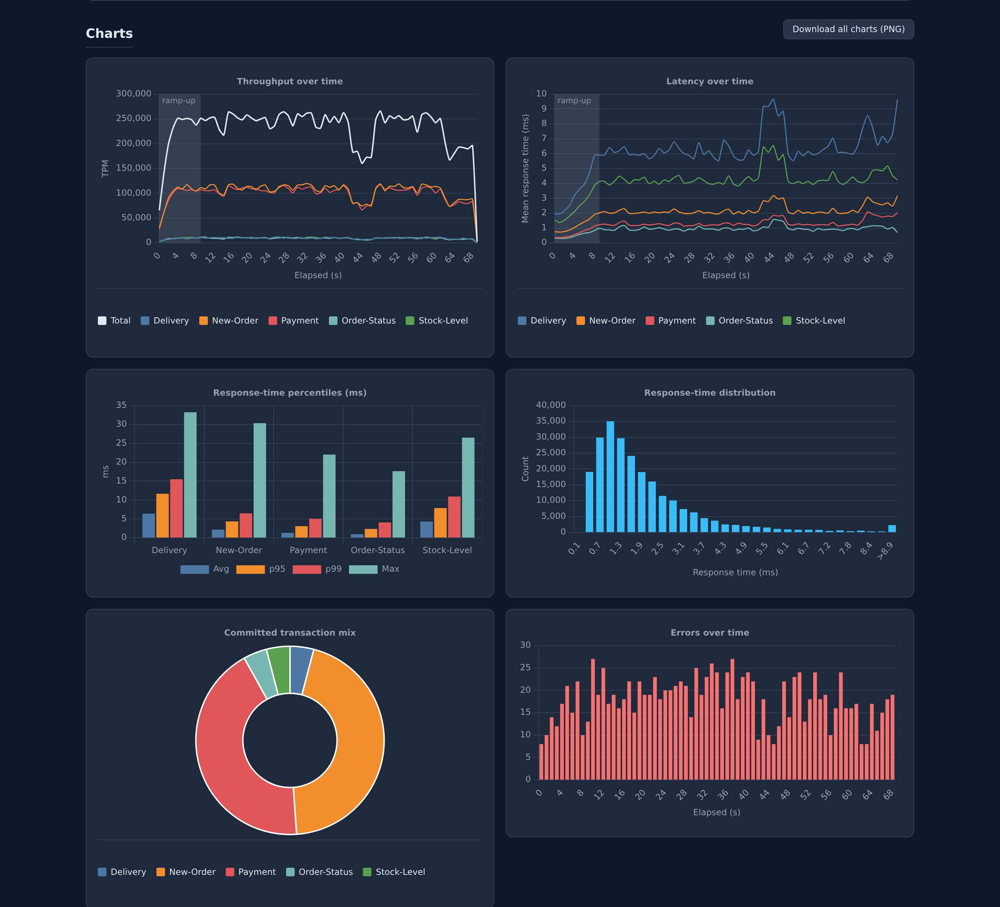

# Reading the results

A run reports in three places: the console, a results directory, and the
HTML report inside that directory. All three describe the steady-state
window, the `-T` seconds after the ramp-up; only the time-series charts and
the raw logs include the ramp-up.

A run is reported in one of two layouts. A **throughput** run, the default,
is judged by its rate over the measured window. A **stream** run is judged
by where its time went, transaction by transaction: the spec picks it with
`metrics.report: stream`, as PGM-H and PGM-DS do, and `run --once` always
uses it.

## The console

With `--format table` (the default), a throughput run ends with:

- **The headline**: overall throughput in the spec's unit (TPM for PGM-C,
  TPS for PGM-B and PGM-IoT, queries per hour for PGM-H and PGM-DS), the number of
  committed transactions, the error rate, the average and the 99th-percentile
  response time. For example
  `24 040 TPM · 24 103 committed · 0.43% errors · 19.82 ms avg · 61.30 ms p99`.
- **The steady-state line** of a timed run, described below. For example
  `steady state: drifted · -13.3% second half · 17.9% variation per second`.
- **Results**, one row per transaction: committed count, errors, error rate,
  throughput in the spec's unit.
- **Response times**, one row per transaction: average, minimum, maximum,
  standard deviation, 95th and 99th percentiles, in milliseconds.

A stream run ends with:

- **The headline**: the elapsed time, the number of executions, the
  geometric mean of the transactions' mean response times, the transaction
  that took the most time with its share, and the errors. For example
  `40.1 s elapsed · 44 executed · 976 ms geomean · slowest Q18-Large-Volume 25.46 s (32.5%) · 0 errors`.
- **Where the time went**, one row per transaction, the most
  time-consuming first: executions, errors, total time and its share, and
  the average, minimum and maximum response times.

During the run, a progress bar on the terminal shows the elapsed time, the
current throughput and the average latency; when stderr is not a terminal,
`--progress N` prints the same figures as a `progress:` line every N
seconds. The rate is the one of the last second, not an average since the
start.

`--format json` prints the same figures as one document (`report`, which is
`throughput` or `stream`, `duration_s`, `interrupted`, `throughput_unit`,
`steady_state`, `stream` and a `transactions` array with `name`,
`committed`, `errors`, `error_rate`, `throughput` and a `latency_ms` object
holding `avg`, `min`, `max`, `p95`, `p99` and `stddev`); `--format csv` prints
one row per transaction with the same columns. Both imply `--quiet`.
`steady_state` holds `verdict`, `seconds`, `mean`, `cv_pct`, `first_half`,
`second_half` and `drift_pct`, or is `null` when the run was not judged.
`stream` holds `elapsed_s`, `executed`, `errors` and `geomean_ms` for a
stream run, and is `null` otherwise; a stream run's transactions also carry
`total_ms` and `share_pct`.

## Steady state

A throughput figure describes a run only if the rate held while it was
measured. pgmeter checks this on the per-second commit counts of the
measured window, without its first and last seconds, in which clients start
and stop:

- **Variation per second** is the coefficient of variation of the
  per-second rate: its standard deviation as a percentage of its mean.
- **Drift** compares the mean rate of the window's second half with its
  first half.

The verdict is `steady` under 10% variation and under 5% drift, `unstable`
when only the variation is over, and `drifted` when the halves differ by 5%
or more. A drifted run averages two regimes, such as a cache warming up or
checkpoints starting, and a longer run may settle at a different rate. A
window under 10 full seconds is not judged, and neither is a stream run.

## The results directory

Each run creates a directory named after its start time in UTC, such as
`pgmeter-20260101T120000Z/`, in the current directory:

| File | Contents |
|---|---|
| `report.html` | The self-contained report described below |
| `run.json` | The run parameters, the elapsed and ramp-up times, the throughput unit, `rampup_end_ts` and whether the run was interrupted |
| `transaction.log` | One line per committed transaction, ramp-up included |
| `error.log` | One line per failed transaction with its message |
| `pgmeter-throughput-<name>.csv` | Throughput per second of each transaction, and `all`, over the whole run |
| `pgmeter-response-time-<name>.csv` | Response time over time of each transaction |
| `pgmeter-stats-<name>.csv` | The statistical summary of each transaction for the steady-state window |

[Output files](../reference/output-files.md) gives the exact format of each.
The two logs are plain text so that a run can be re-analysed with other tools;
`rampup_end_ts` in `run.json` is the `transaction.log` timestamp at which the
steady-state window starts.

## The HTML report

`report.html` opens offline in any browser: the chart library is inlined and
nothing is fetched. It shows:

- An environment header: benchmark name and description, PostgreSQL version,
  key server settings (`shared_buffers`, `work_mem`, `max_wal_size`,
  `max_connections`, `effective_cache_size`) and the run parameters.
- The data set: tables and indexes with their sizes.

A throughput run's report then shows:

- The headline figures: throughput, committed transactions, errors and error
  rate, and the average, 95th and 99th percentile response times.
- The steady-state verdict with its figures.
- The per-transaction results table.
- Charts: throughput over time with the mean of each half of the window
  dashed, latency over time as the mean and the 95th percentile of all
  transactions or of the one picked in the chart's selector, the response-time
  distribution and errors over time; for specs with several transactions,
  also the response-time percentiles per transaction and the committed
  transaction mix. The ramp-up window is shaded.

A stream run's report shows instead:

- The headline figures: elapsed time, executions, the geometric mean of the
  response times, the transaction that took the most time with its share,
  and errors.
- Where the time went: the total time of each transaction as a bar, the
  slowest first. The 16 slowest are drawn and the rest grouped, unless *Show
  all* is pressed; *Log scale* brings the short ones into view.
- The stream timeline: one lane per client and one bar per execution, where
  it ran, the slowest transaction highlighted. It is drawn up to 20,000
  executions.
- The per-transaction table: rank, executions, errors, total time, share
  and cumulative share, and the average, minimum and maximum response times.
  Any column sorts, and a filter matches names.

[View a sample report](../sample-report.html): a PGM-C run with 10 warehouses
and 8 clients for 60 s after a 10 s ramp-up. Hover the charts; the page has a
light and a dark theme.

## Comparing runs

The figures that matter for a comparison are the headline throughput and
the per-transaction percentiles, at the same scale factor, client count and
duration. [Measuring well](measuring.md) lists the habits that make such a
comparison hold: reload before each run, discard the first run after a load,
ramp up and measure long enough, repeat, and watch the server log.
